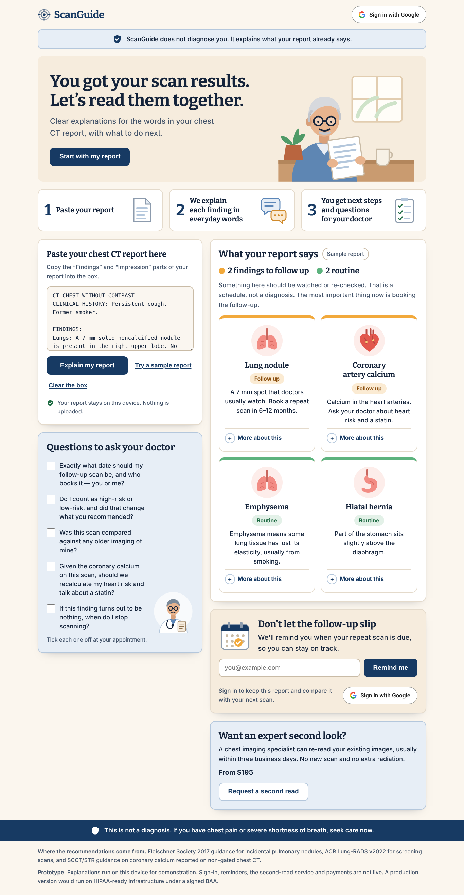

# ScanGuide

A patient-facing web page that explains a chest CT report in plain language for adults aged 60+. Paste the report and ScanGuide shows each finding as a picture card (lungs, heart, stomach) with a traffic-light label, a one-line explanation, and the recommended follow-up. It also lists questions to take to the doctor, with a reminder so the follow-up scan isn't missed.

**Live demo:** open `index.html` in any browser. It's a single file with no build step, and the report never leaves the device.



## Design

- **Large type:** body text is 19–20px and nothing is smaller than 16px.
- **Easy targets:** buttons and fields are 48px+ tall.
- **High contrast.**
- **One idea per card.**
- **Pictures first:** pictures carry the meaning before the words do. Illustrations are inline SVG, so they stay sharp at any screen size and work offline.
- **Phone order:** report, results, then questions.

## Guidance used

- Fleischner Society 2017 for incidental pulmonary nodules
- ACR Lung-RADS v2022 for screening scans
- SCCT/STR guidance on coronary calcium on non-gated chest CT

## Tests

`tests/test_scanguide.py` renders the page with Playwright at six sizes, from a 320px phone to a 1920px desktop. At each size it checks for:
- horizontal scrolling and elements falling off screen
- text under 16px and tap targets under 44px
- missing pictures and JavaScript errors
- correct results for the sample report

It also runs the full flow: details, checklist, reminder validation, clearing the box, a custom report, the empty state and sign-in. Finally it runs an axe-core WCAG 2.1 AA scan.

```bash
pip install playwright && playwright install chromium
npm i axe-core@4
python tests/test_scanguide.py index.html screenshots-out
```

## Status

ScanGuide is a prototype and not a diagnostic tool. Sign-in, reminders and the second-read service are simulated. A production version would run on HIPAA-ready infrastructure under a signed BAA.
